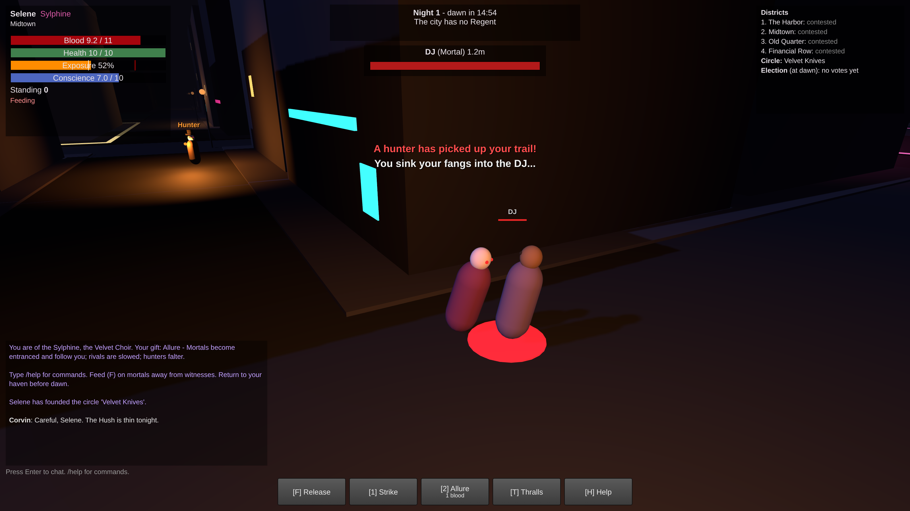

# Sanguine City

An online vampire sandbox built in **Unity**. It draws on what is publicly known about CCP Games'
cancelled *World of Darkness* MMO (2006–2014): a politics-first sandbox with open PvP, a secrecy
mechanic, feeding on humans and ghoul-style minion missions. The setting and rules are original.



*Preview: Selene, a Sylphine fledgling, feeds on a reporter under a Midtown street lamp. Witnesses have pushed her exposure to 78%, and a hunter (right) has picked up her trail. The game state and the city layout come from the real server and the shared `CityDressing` code, and the image uses the game's own art. It is a browser re-creation (three.js), not a Unity render, so lighting is approximate. Characters are shown with the built-in fallback figure (see [Characters](#characters)).*

- **[Docs/RESEARCH.md](Docs/RESEARCH.md)**: what design material exists for the cancelled game, what it says, and sources.
- **[Docs/DESIGN.md](Docs/DESIGN.md)**: the game design document for Sanguine City.

## Features

- **Six bloodlines with three gifts each.** The first is innate; the other two are learned by spending standing, which also weights your Regent vote.
  - **Vorlen:** Surge, Iron Skin, Earthshaker.
  - **Sylphine:** Allure, Glamour, Rapture.
  - **Ashborn:** Blood Lash, Siphon, Crimson Mist.
  - **Aurum:** Command, Majesty, Dominate.
  - **Umbren** (spies): Shroud (unseen beyond 6 m), Whispers (sense every vampire within 150 m), Undercroft (tunnel home to the haven).
  - **Varga** (feral pack): Pounce (leap onto a target), Pack Howl (cow hunters, speed up allies), Unchained (fast strikes that heal).
  The full table is in [DESIGN.md](Docs/DESIGN.md#4-bloodlines-and-gifts).
- **Sires and childer.** A fledgling can accept the Embrace from an elder and is remade in the sire's bloodline.
  - The sire teaches gifts for less standing and answers for the childe's crimes until releasing them.
  - Sire and childe can't harm each other, are stronger side by side and feel each other fall.
  - The whole family shares a chat channel. See [DESIGN.md](Docs/DESIGN.md#64-lineage-sires-and-childer).
- **Feeding** on a living crowd of mortals in four districts, and the choice to release them in time or let them die.
- **The Hush:** witnesses raise your Exposure. Hunters come at 50%, and at 80% any vampire may kill you.
- **Conscience:** killing mortals lets the Beast take over.
- **Open PvP** with consequences (Outlaw / Marked), plus safe **havens** and neutral **sanctums**.
- **Night/day cycle.** Be indoors at dawn or burn.
- **Circles** (player factions), **thrall missions** that win **district control**, a nightly **Regent election**,
  **edicts** and **blood hunts**.
- **Authoritative server** with persistence (characters, circles, influence, regent).
- **Realistic CC0 art:**
  - photoscanned PBR textures for roads, sidewalks and walls;
  - building facades with lit-window emission maps;
  - 20 Poly Haven street props (lampposts, parked cars, hydrants, trash cans, roller shutters, fire escapes, aircon units, fire barrels, harbour freight);
  - HDR night and day skies.
  All of it is listed in [CREDITS.md](CREDITS.md).
- **Night-city rendering:**
  - deferred HDR camera with about 390 real lights; the nearest lamps cast shadows;
  - wet streets with realtime reflections;
  - bloom, ambient occlusion, screen-space reflections and ACES grading.
- **Soundscape:**
  - night-city and daytime ambience, rain on the wet streets and a dark ambient score;
  - fire barrels crackle and neon buzzes where they stand;
  - footsteps change between wet asphalt, pavement and cobbles;
  - feeding has a bite and a quickening heartbeat, and strikes, all 18 gifts (down to the Varga howl and its answering strays), torpor, sunlight, danger and the dawn bell all have cues;
  - in the Embrace, the fledgling's racing heart slows until it beats as one with the sire's;
  - havens and sanctums muffle the street noise.
- **Still runs without any art:** if the art or packages are missing, the game falls back to flat colours and simple shapes. Open the project and press Play.

## Quick start (Unity)

1. Open this folder with **Unity 6 (6000.0 LTS)** or Unity 2022.3.67+, using the Built-in render pipeline.
   - The Package Manager installs **glTFast** (it imports the props) and **Post Processing**.
   - On first load, the project switches itself to Linear colour space.
2. Open any scene (an empty one is fine) and press **Play**. Alternatively, run **Sanguine ▸ Create Main Scene** first.
3. Enter a name and password, pick a bloodline, and click **Host & Play**.
   - This starts the embedded server on port 7777 and joins it.
   - Friends can then click **Join Server** with your IP address.
   - Saves go to `Application.persistentDataPath/server-save`.

Make builds from **Sanguine ▸ Build ▸ …**:
- Windows, macOS and Linux clients.
- A Linux **Dedicated Server**. Run it with `-server -batchmode -nographics --port 7777`.

## Art pipeline

All third-party art is CC0. It comes from [Poly Haven](https://polyhaven.com) and [ambientCG](https://ambientcg.com) and is generated reproducibly:

```bash
cd Tools/assets && npm install && cd ../..
python3 Tools/assets/build_assets.py      # downloads, converts and writes Assets/Sanguine/Resources
```

The script:
- packs the PBR maps the way Unity's Standard shader expects them;
- splits, recentres and simplifies the props, then writes them as GLB;
- generates `PropCatalog.g.cs` and `CREDITS.md`.

`CityDressing` (shared, engine-free code) decides every building's facade and where each lamp, car, door, fire escape and light goes. The Unity client and the preview tool therefore build the same city.

## Audio

All sounds are original and synthesised by `Tools/audio/synth_audio.py` (numpy + ffmpeg/libvorbis), so they carry no third-party license:

```bash
python3 Tools/audio/synth_audio.py      # writes 47 Ogg Vorbis files (~2.4 MB) to Assets/Sanguine/Resources/Audio
```

Loops are built with circular processing, so they repeat without clicks. `AudioDirector` drives everything from the state the client already receives, so no gameplay code calls into audio. Master and music volume are set in the main menu.

## Characters

Characters are data-driven:
- Drop rigged human models into `Assets/Sanguine/Resources/Characters/{Vampires,Mortals,Hunters,Any}/`.
- Drop animation clips (Idle, Walk, Run, optionally Feed/Bite and Death) into `Assets/Sanguine/Resources/Animations/`.

The importer sets them up as Humanoid, so any humanoid rig works, for example Mixamo, Microsoft Rocketbox or MakeHuman exports. They are animated with the Playables API, so no animator controller is needed. Without such assets, an articulated fallback figure with a procedural walk and run cycle is used.

The repository doesn't ship realistic human models yet. None of the CC0 sources used here have any, and licensed sources need your decision, so check the license before committing characters to a public repository. Mixamo assets, for example, can be used in your game but not redistributed as files.

## Preview screenshots without Unity

`Tools/preview/make_preview.sh` produces a screenshot like the one above (see [Tools/preview/README.md](Tools/preview/README.md) for the exact command). It:
1. runs the real server and scripts a short scene with bot players;
2. exports the live state and the full `CityDressing`;
3. renders that with three.js in headless Chromium, using the same art.

## Controls

| Key | Action |
|---|---|
| WASD / arrows | Move |
| Right-drag, Q/E, mouse wheel | Orbit and zoom the camera |
| Left click / Tab | Select a target / cycle through nearby targets |
| F | Feed on the targeted (or nearest) mortal / release them |
| 1 | Strike |
| 2 / 3 / 4 | Use your bloodline's three gifts |
| G | Gifts panel (learn new gifts with standing) |
| T | Thrall panel |
| L | Lineage panel (Embrace, release, disown) |
| Enter | Chat (`/help` for commands) |
| H / F1 | Help |
| Esc | Clear target, close panels |

Chat commands: `/help /who /stats /districts /gifts /learn /say /c /lin /city /circle … /vote /thrall /hunt /edict /embrace /accept /refuse /lineage …`.

## Releases

[GitHub Releases](https://github.com/LeonG-ZA/vamp/releases) carry the dedicated server for Linux and Windows as single self-contained executables (no .NET install needed). Play the client from the source in Unity.

To make a release, write the notes in `Docs/releases/<tag>.md`. Then either open **Actions ▸ Release ▸ Run workflow** and enter the tag (for example `v0.2.0`), or push one:

```bash
git tag -a v0.2.0 -m "Sanguine City 0.2.0" && git push origin v0.2.0
```

`.github/workflows/release.yml` then runs the integration test, builds the servers and publishes the release. A run started from the Actions tab creates the tag on the branch's latest commit. `v0.x` tags are published as pre-releases.

## Dedicated server without Unity

The server is plain C# with no UnityEngine dependency. The same source files compile into Unity and into a console app:

```bash
# .NET 8 SDK
dotnet run --project Server/SanguineServer.csproj -- --port 7777 --save ./save

# or Mono
Server/build.sh
mono Server/bin/SanguineServer.exe --port 7777 --save ./save
```

Server options: `--port --seed --save --night --day --mortals --max-players --debug`.
`--debug` enables the test commands `/tp x z`, `/dawn`, `/setexposure n`, `/setblood n` and `/pos`. Never enable it on a public server.

## Tests

`Server/Tests/IntegrationTest.cs` starts a real server and connects three scripted bot clients over TCP. It exercises:
- login, duplicate login and password checks;
- circles and invitations;
- feeding and restraint;
- thrall missions;
- voting, dawn, the Regent and blood hunts;
- PvP rules (circle immunity, Outlaw, torpor and respawn) and sanctums;
- collision with buildings and hunters routing around them along the streets;
- learning gifts with standing and the main gift effects (Siphon, Iron Skin, Dominate, Majesty, Crimson Mist);
- the Embrace and lineage: offers, the bloodline change, the blood bond, lineage chat, kin protection, taught gifts, a sire's shame, release and renouncing;
- the Umbren and Varga gifts (Shroud hiding and breaking, Whispers, the Undercroft trip home, Pounce, Pack Howl, Unchained immunity);
- persistence across a server restart.

```bash
Server/build.sh && mono Server/bin/SanguineTests.exe     # 99 passed, 0 failed
# or with the .NET 8 SDK
dotnet run --project Server/Tests/SanguineTests.csproj
```

## Project layout

```
Assets/Sanguine/Scripts/Core/      Sanguine.Core asmdef (no UnityEngine): shared + server
  Shared/  GameData (rules, bloodlines, districts), CityLayout (deterministic city), Protocol, Connection (TCP framing)
  Server/  GameServer (+ .Rules / .Ai / .Politics / .Lineage), Entities, Persistence, ServerConfig
Assets/Sanguine/Scripts/Client/    Sanguine.Client asmdef: Bootstrap, GameClient, LocalPlayer, EntityView,
                                   CityBuilder, Atmosphere, ClientUI (IMGUI), Mats
Assets/Sanguine/Scripts/Editor/    Menu items: create scene, build clients / dedicated server
Server/                            Standalone dedicated server (csproj + Mono build script) and integration test (csproj)
.github/workflows/release.yml      Tag-triggered release: tests, server builds, GitHub release
Docs/                              Research notes, the design document and release notes
Tools/assets/                      CC0 art download + conversion pipeline (Python + glTF-Transform)
Tools/preview/                     Live-server scene export + three.js preview renderer
Assets/Sanguine/Resources/         Generated art: Textures/, Props/ (GLB), Sky/ (HDR), templates, sky shader
```

## Notes and limitations

- This is a playable prototype, not a production MMO.
  - Movement is client-predicted. The server checks speed and building collision, but small props such as parked cars are only solid on the client.
  - Transport is TCP.
  - Persistence uses flat files.
  - See the roadmap in `Docs/DESIGN.md`.
- WebGL is not supported, because it has no threads or raw sockets.
- IP notice: *World of Darkness* and *Vampire: The Masquerade* are trademarks of Paradox Interactive.
  - This project is not affiliated with them or with CCP Games.
  - It uses none of their names, characters, clans, setting text or assets.
